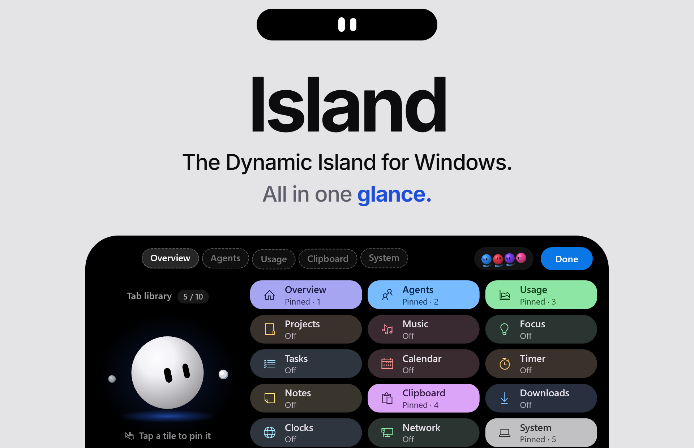
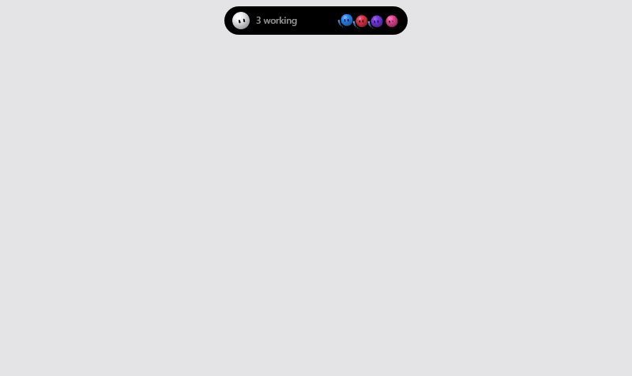
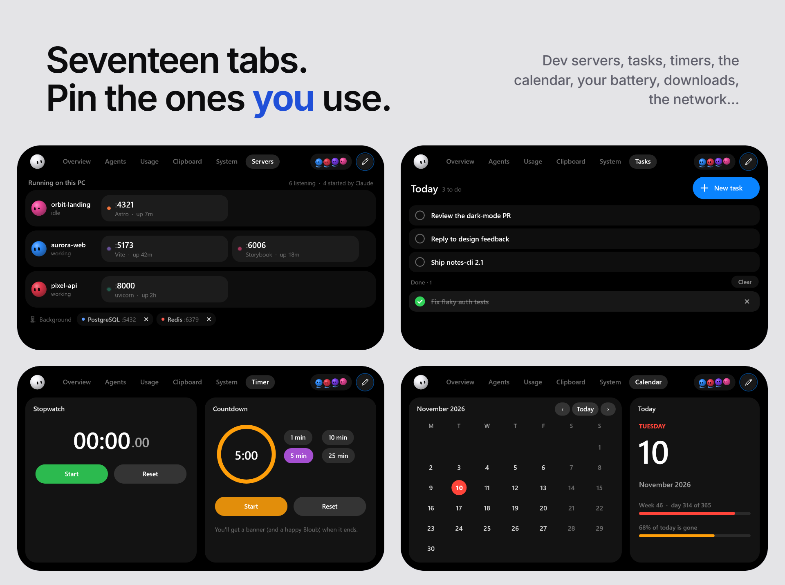
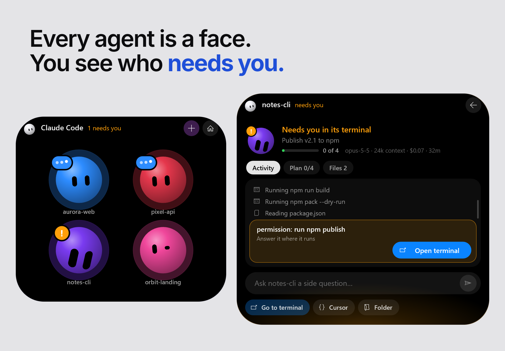
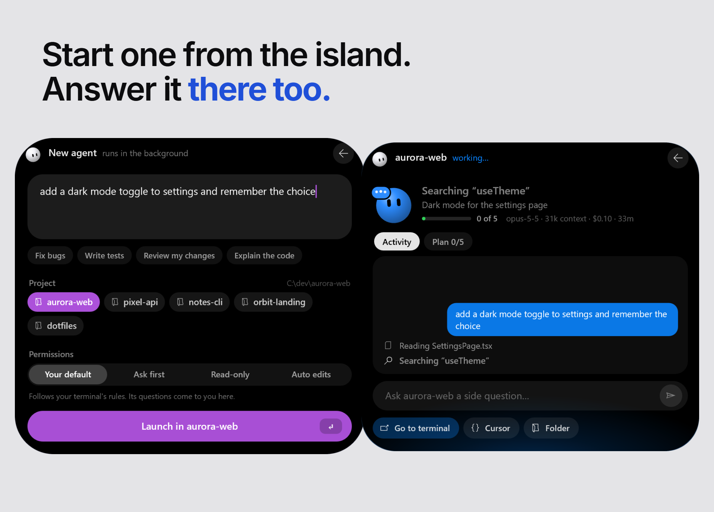
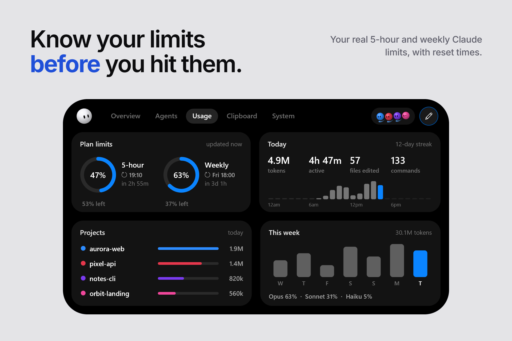
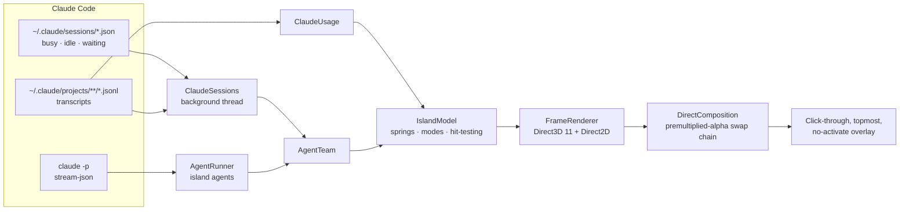

<div align="center">



A living black pill at the top of your screen. Hover it, and it opens into whatever you keep checking:<br>
your dev servers, tasks and timers, your AI agents, your plan limits, and live tabs you make by describing them.

<a href="https://github.com/UsoguiH/dynamic-island-windows/releases/latest/download/DynamicIsland-win-Setup.exe"></a>

<sub>Free and open source · Windows 10 and 11 · no admin rights, no account · updates itself</sub><br>
<sub><a href="https://github.com/UsoguiH/dynamic-island-windows/releases">All downloads</a> · <a href="#try-it-first">Try the demo mode first</a></sub>

<br>

[](https://github.com/UsoguiH/dynamic-island-windows/actions/workflows/build.yml)
[](https://github.com/UsoguiH/dynamic-island-windows/releases/latest)
[](https://github.com/UsoguiH/dynamic-island-windows/releases)
[](LICENSE)
[](https://github.com/UsoguiH/dynamic-island-windows/stargazers)

<br>



<sub>The app itself, in its demo mode. Every picture on this page is drawn by the app. Nothing is a mock-up.</sub>

</div>

## What's in the pill

| | |
|---|---|
| **[Seventeen tabs](#seventeen-tabs-pin-the-ones-you-use)** | Dev servers, tasks, notes, timers, focus sessions, the calendar, world clocks, battery, downloads, network. Pin the ones you use. |
| **[Tabs you describe](#describe-a-tab-and-it-builds-itself)** | Say *"bitcoin price with a chart"* or *"today's Premier League matches"* and a live tab builds itself. |
| **[Your AI agents](#your-ai-agents-as-a-team)** | Every Claude Code session is a coloured face: working, done, or waiting for you. Start new ones and answer them from the island. |
| **[Your limits](#know-your-limits-before-you-hit-them)** | Your real 5-hour and weekly Claude limits, and what you used today. |
| **[Bloub](#bloub)** | The mascot who lives in the pill. He winks, he shrugs, and he jumps out to tell you when something is done. |
| **[Never in your way](#never-in-your-way)** | Click-through, never steals focus, folds into a thin line over your browser tabs, hides in fullscreen games. |

It is **native** (C# and Direct3D, no Electron), it draws only what changed, and everything stays **on your PC**.

## Install in 10 seconds

1. **[Download Setup.exe](https://github.com/UsoguiH/dynamic-island-windows/releases/latest/download/DynamicIsland-win-Setup.exe)** and run it. No admin rights, no .NET to install, no account.
2. Bloub drops in to say hi, and the island sits at the top of your screen.
3. It **updates itself**: a new version downloads in the background and installs the next time the island closes.

Prefer no installer? Get the **[portable zip](https://github.com/UsoguiH/dynamic-island-windows/releases/latest/download/DynamicIsland-win-Portable.zip)**, unzip it anywhere and run `IslandLab.exe`.

> [!NOTE]
> The app isn't code-signed yet, so Windows SmartScreen may warn you the first time: click **More info → Run anyway**. The whole source is here if you'd rather [build it yourself](#build-from-source).

**Requirements:** Windows 10 (1903+) or 11, 64-bit, any DirectX 11 GPU.

### Try it first

**Demo mode** fills the island with a scripted team of agents, servers, usage and limits. Nothing is read from your disk:

```powershell
IslandLab.exe --showcase
```

### Uninstall

Windows Settings → Apps → **Island** → Uninstall. Your tabs, tasks and notes live in `%APPDATA%\Island` and are yours to keep or delete.

## Seventeen tabs. Pin the ones you use.



Click the pill and it opens into a dashboard. Each tab is one thing you would otherwise open a window for:

| | |
|---|---|
| **Servers** | Every dev server listening on localhost (Vite, Next.js, uvicorn, Postgres, Redis…), with how long it's been up. **Open** it in the browser or **Stop** it (asks twice). |
| **Tasks · Notes** | A to-do list and quick notes, saved on your PC. |
| **Timer · Focus** | Stopwatch with laps, countdown with presets, deep-work sessions. |
| **Calendar · Clocks** | The month at a glance, how much of today is gone, and world clocks. |
| **Battery** | Charge ring, time left, power mode and battery saver. A banner when you plug in or unplug. |
| **Downloads · Network** | Your latest downloads (open or show in folder) and live up/down speed. |
| **Projects** | Your recent projects: open in your editor or Explorer, or start an agent there. |
| **Overview · Agents · Usage** | Everything at a glance, your AI sessions, and your limits. |

Click the pencil to open the **tab library**: tap a tile to pin it to your bar, tap again to unpin, drag to reorder. You can pin up to 10, and your choice is saved.

## Describe a tab, and it builds itself

<p align="center"></p>

Open the tab library, tap **New tab** and say what you want to keep an eye on, in your own words: *"bitcoin price with a chart"*, *"today's Premier League matches"*, *"new anime episodes with posters"*, *"prayer times in Riyadh"*. Bloub finds a free live source for it, lays it out (a price chart, score rows, a shelf of posters, a card per day…) and fills it with real data while you watch.

- **Change it by asking again:** on the result, press **Change it** and say what should be different ("make it green", "show the last 7 days", "bigger pictures"). The same tab comes back changed.
- After that, the tab refreshes by itself. No AI runs again and nothing leaves your PC except the request to that source.
- Building a tab uses your own [Claude Code](https://claude.com/claude-code), once. Everything else in Island works without it.

## Your AI agents, as a team



You start an agent, switch to something else "for a minute", and come back 47 minutes later. It asked **Allow this edit?** two minutes after you left.

With Island, every running Claude Code session is a coloured Bloub in the pill, and the moment one of them finishes or needs you, the island says which one and why. Click an agent to open it:

- **Live activity:** "Editing theme.ts → Running npm test", built from the session's transcript
- **Plan and files:** its to-do list with progress, and every file it changed
- **Needs you:** an orange badge and an alert when a session is waiting on you
- **Side questions:** ask a running session something without interrupting it (Island asks a read-only fork)
- **Go to terminal:** jumps straight to that session's window

**Zero config.** Island reads Claude Code's own session registry (`~/.claude/sessions`) and transcripts. It doesn't need hooks and doesn't touch your `settings.json`.



Press **+**, say what it should do, pick one of your recent projects and choose how much it may do on its own. The agent runs in the background, and you answer its **Allow / Deny** prompts and its questions right from the island. You can message it, stop it, restart it or continue it in a terminal (`claude --resume`) whenever you want.

## Know your limits before you hit them



- **Plan limits:** your real 5-hour and weekly usage rings with reset times, plus banners at 80% and 95%
- **Today:** tokens, active time, files edited and commands run, with hour, project, week and model breakdowns
- Everything is computed locally from `~/.claude/projects/**/*.jsonl`

## Bloub

<p align="center"></p>

Bloub is the face in the pill. He looks where your cursor goes, blinks, and reacts to what you do: pin a tab and he **winks**, unpin one and he **shrugs**, with his two moons lifting like shoulders.

When an agent finishes while you are looking elsewhere, Bloub **leaps out of the island**, lands next to your cursor and says it's done, with confetti in the agent's colour. Then he flies home. It happens at most once every 12 s, and never during a fullscreen game.

## Never in your way

- **Click-through** everywhere except the black shape, and it **never steals focus**
- **Auto-retract:** when a window's tabs sit under the island, it folds into a thin line. Touch the line to bring it back.
- **Reserved bar** (optional): reserves a 40 px strip, so maximised windows start below the island
- **Hides in fullscreen games** automatically
- **One instance:** launching it again just opens the running island

## Questions

**Is it free?** Yes. MIT licence, no paid tier, no account.

**Do I need Claude Code?** No. Without it you still get the island, the tabs and the demo mode. With it, your agents show up by themselves.

**Does it slow my PC down?** It redraws only what changed, so at rest it uses almost nothing, and it gets out of the way of fullscreen games.

**Does it send anything anywhere?** No telemetry, no account, no server. See [Privacy](#privacy).

**Will it cover my browser tabs?** Over a window it folds into a thin line, and only touching that line opens it.

**Does it work with other agents (Codex, Gemini, Cursor)?** Not yet. Claude Code today; others are the next big step. Tell us which one you want in [an issue](https://github.com/UsoguiH/dynamic-island-windows/issues).

**Can I answer an agent from the island?** Agents you start from the island: yes, Allow / Deny and its questions appear right there. Sessions you started in a terminal: the island tells you which one is waiting, and one click takes you to its window.

**Windows says the app is unknown. Is it safe?** It isn't code-signed yet, so SmartScreen warns the first time (**More info → Run anyway**). Every line of the source is in this repository, and the installer is built from it by [GitHub Actions](.github/workflows/release.yml).

**How do I stop it?** Right-click the tray icon → Quit, or `Ctrl+Alt+Q`.

## Build from source

```powershell
git clone https://github.com/UsoguiH/dynamic-island-windows
cd dynamic-island-windows
dotnet run --project src/Island.Lab -c Release              # needs the .NET 10 SDK
dotnet run --project src/Island.Lab -c Release -- --showcase  # sample agents & usage
```

Single-file exe, the same as the release build:

```powershell
dotnet publish src/Island.Lab -c Release -p:PublishSingleFile=true -p:IncludeNativeLibrariesForSelfExtract=true -p:EnableCompressionInSingleFile=true -o publish
```

## Hotkeys

| Keys | Action |
|---|---|
| **Hover** the pill | Dashboard (centre) or agent team (the coloured Bloubs) |
| **Click** the pill | Open the dashboard · right-click collapses |
| `Ctrl+Alt+A` | Agent team |
| `Ctrl+Alt+D` | Preview the "done" celebration |
| `Ctrl+Alt+W` | Replay the intro |
| `Ctrl+Alt+H` | Toggle auto-retract (falls back to `R` or `J` if `H` is taken) |
| `Ctrl+Alt+B` | Toggle the reserved bar |
| `Ctrl+Alt+1` … `9` | Jump to a state: dormant, media, split, alert, expanded, dashboard, command bar, focus, Bloub gallery |
| `Ctrl+Alt+0` | Slow motion (0.2×) |
| `Ctrl+Alt+Q` | Quit |

**Options:** `--showcase` (or `ISLAND_SHOWCASE=1`) runs the scripted demo, and `ISLAND_RETRACT=0` starts with auto-retract off. Your tabs, tasks and notes are saved in `%APPDATA%\Island\settings.json`.

## How it works



| Layer | Choice | Why |
|---|---|---|
| Window | Raw Win32: `WS_EX_NOREDIRECTIONBITMAP`, topmost, no-activate | True per-pixel transparency; clicks pass through everything but the shape |
| Composition | DirectComposition + DXGI flip-model swap chain | Tear-free, vsync at the monitor's refresh rate |
| Rendering | Direct3D 11 + Direct2D/DirectWrite via [Vortice.Windows](https://github.com/amerkoleci/Vortice.Windows) | Every pixel is ours, so the motion is exactly what we design |
| Motion | Analytic damped springs (SwiftUI-style `response` / `dampingFraction`) | Interruptible and retargetable without losing velocity |
| Mascot | Bloub engine: radial body profile + eye cut-outs, pure functions of time | Deterministic, testable, blends any state into any other |

The full design doc covers the spring tokens, the choreography, the state sizes and the feature plan: **[docs/PLAN.md](docs/PLAN.md)**.

## Privacy

Island is **local-only**. It has no telemetry, no account and no server.

- It **reads** Claude Code's session registry and transcripts under `~/.claude` to show your agents and usage. It never writes to them.
- To show your real plan limits, it runs a tiny `claude -p` probe on Haiku (~650 tokens, about $0.001) at start, then every 10 minutes (every 2 minutes while the dashboard is open). Agents launched from the island report limits for free, so they skip the probe.
- `--showcase` reads nothing from your disk and runs no probe.

## Roadmap

- [x] Shape, springs, gooey split, content choreography
- [x] Bloub: 15 states, 17 moods, 8 shapes, gaze, blinking
- [x] Claude Code agent team, island agents, Allow/Deny, side questions
- [x] Usage & plan limits, "done" celebration, intro, tray, autostart
- [x] Auto-retract, reserved bar, fullscreen-game hiding
- [x] Tab library with 17 tabs: dev servers, battery, projects, tasks, notes, timers, calendar, clocks, downloads, network
- [ ] **Now Playing** from Windows media controls (SMTC) with a live waveform
- [ ] Approve Claude Code permission prompts for *terminal* sessions (`PermissionRequest` hook)
- [ ] Clipboard history and a file shelf
- [ ] Real system monitor, audio device switcher
- [ ] Settings window, themes and Bloub skins, multi-monitor
- [x] Installer and auto-update
- [x] Describe a tab in words: live tabs that build themselves
- [ ] Code signing

What changed in each version: **[CHANGELOG.md](CHANGELOG.md)**. Have an idea? [Open a feature request](https://github.com/UsoguiH/dynamic-island-windows/issues/new?template=feature_request.yml).

## Contributing

PRs are very welcome, especially for the roadmap items above. Read **[CONTRIBUTING.md](CONTRIBUTING.md)** first: it explains the code layout and the one rule that matters most (*motion quality first*).

## Credits

- **Bloub**, the mascot engine, is by [Jérémy Perret](https://github.com/jeremy-prt/bloub) (MIT) and ported to C# here. See [THIRD_PARTY_NOTICES.md](THIRD_PARTY_NOTICES.md).
- Rendering via [Vortice.Windows](https://github.com/amerkoleci/Vortice.Windows) (MIT).
- Inspired by Apple's Dynamic Island and by Mac notch apps for coding agents.

Island is an independent project. It isn't affiliated with Apple or Anthropic. "Claude" and "Claude Code" are Anthropic trademarks, used here only to say what the app works with.

## License

[MIT](LICENSE) © 2026 UsoguiH

<div align="center">
<br>

### Ready? It takes 10 seconds.

<a href="https://github.com/UsoguiH/dynamic-island-windows/releases/latest/download/DynamicIsland-win-Setup.exe"></a>

<br><br>

**If Bloub made you smile, a ⭐ helps other people find it.**

<a href="https://star-history.com/#UsoguiH/dynamic-island-windows&Date">
  
</a>

</div>
