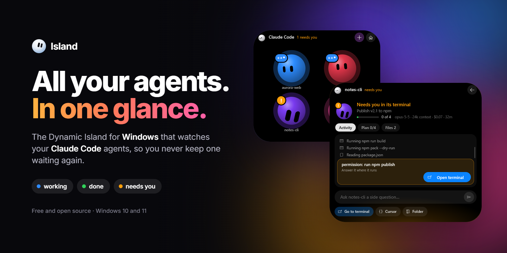
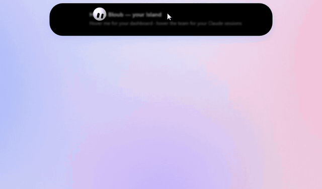
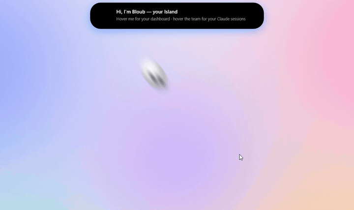
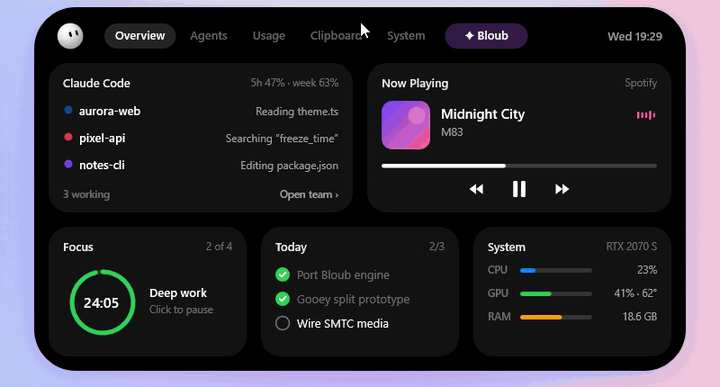
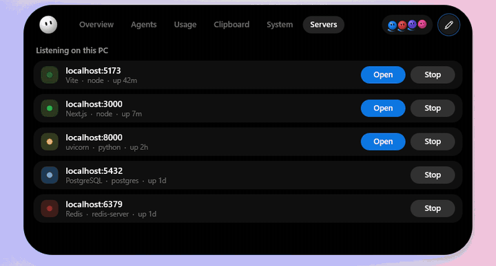
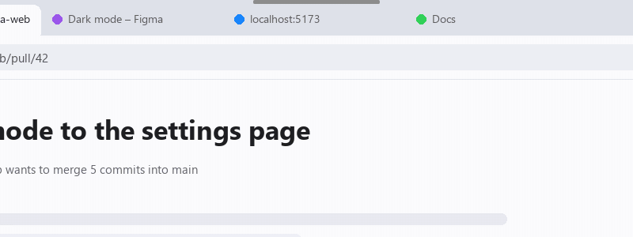
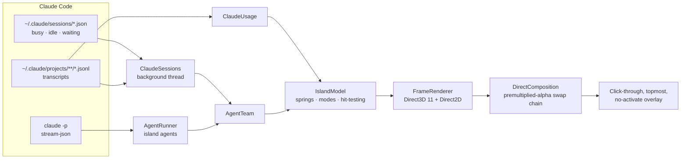

<div align="center">



# Island

### The Dynamic Island for Windows that watches your AI coding agents

A small black pill at the top of your screen. It shows which of your Claude Code agents are **working**,<br>
which are **done** and which **need you**, and lets you answer them without leaving what you're doing.

<a href="https://github.com/UsoguiH/dynamic-island-windows/releases/latest/download/DynamicIsland-win-Setup.exe"></a>

<sub>Free and open source · Windows 10 and 11 · installs in seconds, updates itself · <a href="#try-it-without-claude-code">no Claude Code? try the demo mode</a></sub>

<br>



[](https://github.com/UsoguiH/dynamic-island-windows/actions/workflows/build.yml)
[](https://github.com/UsoguiH/dynamic-island-windows/releases/latest)
[](LICENSE)
[](https://github.com/UsoguiH/dynamic-island-windows/stargazers)

</div>

---

## What it is, in 30 seconds

You run AI coding agents in terminals. They work for minutes, then stop to ask a question, or finish while you are looking at something else, and you find out late. Island puts all of them in one place you can always see.

| | |
|---|---|
| **See** | Every Claude Code session on your PC is a small coloured face in the pill: working, done, or waiting for you. |
| **Know** | When one finishes, the mascot (his name is **Bloub**) jumps out next to your cursor and tells you. When one needs you, the island says which one and why. |
| **Act** | Start a new agent, answer its Allow / Deny questions and read its plan and changed files, all from the island. |
| **And more** | Your real Claude plan limits, your dev servers, tasks, timers, and live tabs you create by describing them in a sentence. |

It needs **no setup**: it reads what Claude Code already writes on your disk. It is **native** (C# and Direct3D, no Electron), runs at your monitor's refresh rate, and everything stays **on your PC**.

<div align="center">


<sub>Real captures of the app, recorded in its demo mode. Nothing here is a mock-up.</sub>
</div>

## Install

1. **[Download Setup.exe](https://github.com/UsoguiH/dynamic-island-windows/releases/latest/download/DynamicIsland-win-Setup.exe)** and run it. That's it: no admin rights, no .NET to install.
2. Bloub drops in to say hi, and the island sits at the top of your screen.
3. It **updates itself**: a new version downloads in the background and installs the next time the island closes.

Prefer no installer? Get the **[portable zip](https://github.com/UsoguiH/dynamic-island-windows/releases/latest/download/DynamicIsland-win-Portable.zip)**, unzip it anywhere and run `IslandLab.exe`.

> [!NOTE]
> The app isn't code-signed yet, so Windows SmartScreen may warn you the first time: click **More info → Run anyway**. The whole source is here if you'd rather [build it yourself](#build-from-source).

**Requirements:** Windows 10 (1903+) or 11, 64-bit, any DirectX 11 GPU. [Claude Code](https://claude.com/claude-code) is optional.

### Try it without Claude Code

Run it in **demo mode** and you get a scripted team of agents, usage and limits. Nothing is read from your disk:

```powershell
IslandLab.exe --showcase
```

### Uninstall

Windows Settings → Apps → **Island** → Uninstall. Your tabs, tasks and notes live in `%APPDATA%\Island` and are yours to keep or delete.

## Contents

- [What it is](#what-it-is-in-30-seconds) · [Install](#install)
- [Features](#features)
- [Build from source](#build-from-source)
- [Hotkeys](#hotkeys)
- [Questions](#questions)
- [How it works](#how-it-works)
- [Privacy](#privacy)
- [Roadmap](#roadmap)
- [Contributing](#contributing) · [Credits](#credits) · [License](#license)

## Features

### Your Claude Code agents as a team

Every running Claude Code session becomes a coloured Bloub in the pill. Hover to see the team, and click an agent to open it:

- **Live activity:** "Editing theme.ts → Running npm test", built from the session's transcript
- **Plan:** the agent's to-do list, with progress
- **Files:** every file it changed, and how many times
- **Needs you:** an orange badge and an alert when a session is waiting on you
- **Side questions:** ask a running session something without interrupting it (Island asks a read-only fork)
- **Go to terminal:** jumps straight to that session's window

**Zero config.** Island reads Claude Code's own session registry (`~/.claude/sessions`) and transcripts. It doesn't need hooks and doesn't touch your `settings.json`.

### Launch agents from the island

Press **+ New agent**, pick one of your recent projects, describe the task (or use a template) and choose a permission mode. The agent runs headless, and you answer **Allow / Deny** prompts and its questions right from the island. You can message it, stop it, restart it or continue it in a terminal (`claude --resume`) whenever you want.

### Bloub comes out when an agent is done



When a session finishes and you're looking elsewhere, Bloub **leaps out of the island**, lands next to your cursor and says it's done, with confetti in the agent's colour. Then it flies home and the island shows a banner.

It plays at most once every 12 s, and never during a fullscreen game.

<br clear="right">

### Usage, plan limits and a dashboard



- **Plan limits:** your real 5-hour and weekly usage rings with reset times, plus banners at 80% and 95%
- **Today:** tokens, active time, files edited and commands run, with hour, project, week and model breakdowns
- Everything is computed locally from `~/.claude/projects/**/*.jsonl`

### 17 tabs, your way


Click the pencil and the dashboard turns into a **tab library**. Bloub floats down into an orb and two moons start circling him. Tap a tile to pin it to your bar: its colour spreads out from your finger and Bloub **winks**. Tap it again to unpin it and Bloub **shrugs** ("oh well"), with the moons lifting like shoulders. Drag the tabs in the bar to reorder them. You can pin up to 10, and your choice is saved.



| | |
|---|---|
| **Servers** | Every dev server listening on localhost (Vite, Next.js, uvicorn, Postgres, Redis…), with how long it's been up. **Open** it in the browser or **Stop** it (asks twice). |
| **Battery** | Charge ring, time left, power mode and battery saver, and the charge over this session. A banner when you plug in or unplug. |
| **Projects** | Your recent Claude Code projects: open in your editor or Explorer, or start a new agent there. |
| **Tasks · Notes** | A to-do list and quick notes, saved on your PC. |
| **Timer · Focus** | Stopwatch with laps, countdown with presets, deep-work sessions. |
| **Calendar · Clocks** | The month at a glance, how much of today is gone, and world clocks. |
| **Downloads · Network** | Your latest downloads (open or show in folder) and live up/down speed. |
| **Overview · Agents · Usage** | Everything at a glance, your sessions, and your limits. |

### Describe a tab, and it builds itself

Open the tab library, tap **New tab** and say what you want to keep an eye on, in your own words: *"bitcoin price with a chart"*, *"today's Premier League matches"*, *"new anime episodes with posters"*, *"prayer times in Riyadh"*. Bloub finds a free live source for it, lays it out (a price chart, score rows, a shelf of posters, a card per day…) and fills it with real data while you watch.

- **Change it by asking again:** on the result, press **Change it** and say what should be different ("make it green", "show the last 7 days", "bigger pictures"). The same tab comes back changed.
- After that, the tab refreshes by itself. No AI runs again and nothing leaves your PC except the request to that source.
- It uses your own Claude Code to build the tab, once.

### Never in your way



- **Auto-retract:** when a window's tabs sit under the island, it folds into a thin line. Hover the line to bring it back, or click it to open the dashboard.
- **Reserved bar** (optional): reserves a 40 px strip, so maximised windows start below the island
- **Click-through** everywhere except the black shape; it **never steals focus**
- **Hides in fullscreen games** automatically
- **One instance:** launching it again just opens the running island

## Build from source

```powershell
git clone https://github.com/UsoguiH/dynamic-island-windows
cd dynamic-island-windows
dotnet run --project src/Island.Lab -c Release              # needs the .NET 10 SDK
dotnet run --project src/Island.Lab -c Release -- --showcase  # sample agents & usage
```

Single-file exe, the same as the release build:

```powershell
dotnet publish src/Island.Lab -c Release -p:PublishSingleFile=true -p:IncludeNativeLibrariesForSelfExtract=true -p:EnableCompressionInSingleFile=true -o publish
```

## Hotkeys

| Keys | Action |
|---|---|
| **Hover** the pill | Dashboard (centre) or agent team (the coloured Bloubs) |
| **Click** the pill | Open the dashboard · right-click collapses |
| `Ctrl+Alt+A` | Agent team |
| `Ctrl+Alt+D` | Preview the "done" celebration |
| `Ctrl+Alt+W` | Replay the intro |
| `Ctrl+Alt+H` | Toggle auto-retract (falls back to `R` or `J` if `H` is taken) |
| `Ctrl+Alt+B` | Toggle the reserved bar |
| `Ctrl+Alt+1` … `9` | Jump to a state: dormant, media, split, alert, expanded, dashboard, command bar, focus, Bloub gallery |
| `Ctrl+Alt+0` | Slow motion (0.2×) |
| `Ctrl+Alt+Q` | Quit |

**Options:** `--showcase` (or `ISLAND_SHOWCASE=1`) runs the scripted demo, and `ISLAND_RETRACT=0` starts with auto-retract off. Your tabs, tasks and notes are saved in `%APPDATA%\Island\settings.json`.

## How it works



| Layer | Choice | Why |
|---|---|---|
| Window | Raw Win32: `WS_EX_NOREDIRECTIONBITMAP`, topmost, no-activate | True per-pixel transparency; clicks pass through everything but the shape |
| Composition | DirectComposition + DXGI flip-model swap chain | Tear-free, vsync at the monitor's refresh rate |
| Rendering | Direct3D 11 + Direct2D/DirectWrite via [Vortice.Windows](https://github.com/amerkoleci/Vortice.Windows) | Every pixel is ours, so the motion is exactly what we design |
| Motion | Analytic damped springs (SwiftUI-style `response` / `dampingFraction`) | Interruptible and retargetable without losing velocity |
| Mascot | Bloub engine: radial body profile + eye cut-outs, pure functions of time | Deterministic, testable, blends any state into any other |

The full design doc covers the spring tokens, the choreography, the state sizes and the feature plan: **[docs/PLAN.md](docs/PLAN.md)**.

## Questions

**Do I need Claude Code?** No. Without it you still get the island, the tabs and the demo mode. With it, your agents show up by themselves.

**Does it slow my PC down?** It redraws only what changed, so at rest it uses almost nothing, and it gets out of the way of fullscreen games.

**Does it send anything anywhere?** No telemetry, no account, no server. See [Privacy](#privacy).

**Will it cover my browser tabs?** Over a window it folds into a thin line, and only touching that line opens it.

**Does it work with other agents (Codex, Gemini, Cursor)?** Not yet. Claude Code today; others are the next big step. Tell us which one you want in [an issue](https://github.com/UsoguiH/dynamic-island-windows/issues).

**How do I stop it?** Right-click the tray icon → Quit, or `Ctrl+Alt+Q`.

## Privacy

Island is **local-only**. It has no telemetry, no account and no server.

- It **reads** Claude Code's session registry and transcripts under `~/.claude` to show your agents and usage. It never writes to them.
- To show your real plan limits, it runs a tiny `claude -p` probe on Haiku (~650 tokens, about $0.001) at start, then every 10 minutes (every 2 minutes while the dashboard is open). Agents launched from the island report limits for free, so they skip the probe.
- `--showcase` reads nothing from your disk and runs no probe.

## Roadmap

- [x] Shape, springs, gooey split, content choreography
- [x] Bloub: 15 states, 17 moods, 8 shapes, gaze, blinking
- [x] Claude Code agent team, island agents, Allow/Deny, side questions
- [x] Usage & plan limits, "done" celebration, intro, tray, autostart
- [x] Auto-retract, reserved bar, fullscreen-game hiding
- [x] Tab library with 17 tabs: dev servers, battery, projects, tasks, notes, timers, calendar, clocks, downloads, network
- [ ] **Now Playing** from Windows media controls (SMTC) with a live waveform
- [ ] Approve Claude Code permission prompts for *terminal* sessions (`PermissionRequest` hook)
- [ ] Clipboard history and a file shelf
- [ ] Real system monitor, audio device switcher
- [ ] Settings window, themes and Bloub skins, multi-monitor
- [x] Installer and auto-update
- [x] Describe a tab in words: live tabs that build themselves
- [ ] Code signing

Have an idea? [Open a feature request](https://github.com/UsoguiH/dynamic-island-windows/issues/new?template=feature_request.yml).

## Contributing

PRs are very welcome, especially for the roadmap items above. Read **[CONTRIBUTING.md](CONTRIBUTING.md)** first: it explains the code layout and the one rule that matters most (*motion quality first*).

## Credits

- **Bloub**, the mascot engine, is by [Jérémy Perret](https://github.com/jeremy-prt/bloub) (MIT) and ported to C# here. See [THIRD_PARTY_NOTICES.md](THIRD_PARTY_NOTICES.md).
- Rendering via [Vortice.Windows](https://github.com/amerkoleci/Vortice.Windows) (MIT).
- Inspired by Apple's Dynamic Island and by Mac notch apps for coding agents.

Island is an independent project. It isn't affiliated with Apple or Anthropic. "Claude" and "Claude Code" are Anthropic trademarks, used here only to say what the app works with.

## License

[MIT](LICENSE) © 2026 UsoguiH

<div align="center">
<br>

**If Bloub made you smile, a ⭐ helps other people find it.**

<a href="https://star-history.com/#UsoguiH/dynamic-island-windows&Date">
  
</a>

</div>
